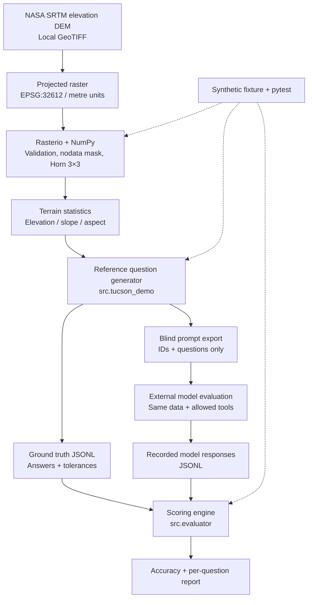

# GeoEarth QA — System architecture

This diagram describes the implemented prototype, not a live deployed service.

## What is already implemented

- Local projected-raster analysis, with explicit CRS/unit validation and nodata handling.
- Ground-truth JSONL generation and separate blind-prompt export.
- Scoring with numeric tolerances, duplicate-ID checks, and non-finite-answer handling.
- Unit and integration tests using synthetic raster fixtures.
- A measured Tucson-area baseline and a six-question reference snapshot.

## Not yet demonstrated

The **external model evaluation** box is a *planned manual step*, not an executed integration. No model accuracy has been measured or published. The CI status of the most recent commit also requires verification.

See [portfolio case study](portfolio_case_study.md) and [terrain baseline](tucson_terrain_baseline.md).
